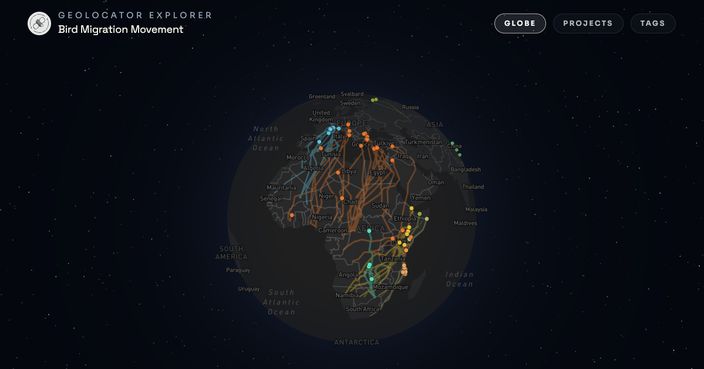

# Reuse a study

A published GeoLocator Data Package contains everything a study produced: the tags, the raw measurements, the labels and the trajectories of all its birds. This chapter shows how to find a package, read it, join its tables, and bring a tag back into GeoPressureR. We use the [South African Woodland Kingfisher](https://doi.org/10.5281/zenodo.13829929) study as an example. To compare many studies, see [Compare studies with the Master](geolocator-master.qmd).

```{r 16-setup}
#| message: false
library(GeoLocatoR)
library(GeoPressureR)
library(tidyverse)
theme_set(theme_minimal(base_size = 12) + theme(panel.grid.minor = element_blank()))
```

## Find a dataset

Browse published packages with the [GeoLocatorExplorer](https://geopressure.org/GeoLocatorExplorer/), or directly in the [geolocator-dp Zenodo community](https://zenodo.org/communities/geolocator-dp).

[{width="100%" alt="Screenshot of GeoLocatorExplorer showing searchable geolocator data packages"}](https://geopressure.org/GeoLocatorExplorer/)

## Read a package

`read_zenodo()` takes a Zenodo record id, a DOI or a Zenodo URL. It downloads the files, upgrades the package to the latest GeoLocator DP version if needed, and returns a `geolocatordp` object.

```{r 16-read-gldp}
#| message: false
#| cache: true
pkg <- read_zenodo("13829929")
```

A record id or DOI can be a *version* (one fixed release) or a *concept* (all versions, resolving to the latest). `13829929` is the concept id of this study, so `pkg$id` gives the version actually read: keep it with your results. `read_zenodo()` downloads every table of the package, including the raw `measurements`. To read only some tables, see [Read only the tables you need](geolocator-master.qmd#read-only-the-tables-you-need).

```{r 16-print-gldp}
#| collapse: true
print(pkg)
```

```{r 16-plot-map}
plot(pkg, "map")
```

Each table has an accessor returning a tibble: `tags()`, `observations()`, `measurements()`, `staps()`, `paths()`, `edges()`, `twilights()` and `pressurepaths()`. Their content is described in [Publish your data](geolocator-create.qmd) and on the [GeoLocator DP website](https://geopressure.org/GeoLocator-DP/).

## Keys and joins

The tables of a package are linked by keys, like a relational database. The [schema overview](https://geopressure.org/GeoLocator-DP/schema-overview/) draws them all.

- A **primary key** identifies each row. In `staps`, it is the pair `tag_id` and `stap_id`: stationary period 3 only means something for a given tag.
- A **foreign key** points to the primary key of another table. `paths` and `edges` point to `staps`, and all tables point to `tags` through `tag_id`.

The trajectory tables add two columns to their primary key:

| Table | Primary key |
|---|---|
| `paths` | `tag_id`, `type`, `j`, `stap_id` |
| `edges` | `tag_id`, `type`, `j`, `stap_s` |
| `pressurepaths` | `tag_id`, `type`, `j`, `datetime` |

`type` is `most_likely`, the single best trajectory (`j = 1`); `simulation`, random draws from the posterior distribution (`j = 1` to `nj`) that carry the location uncertainty; `geopressureviz`, a path edited by hand in `geopressureviz()`; or `tag`, the most likely position of each stationary period taken separately from its likelihood map, without the movement model. **Always join trajectory tables on `type` and `j`**, or you will mix trajectories.

In dplyr, a join takes the keys in `by`. When the columns have different names, `join_by()` maps them. For example, to get the position where each flight started, join `edges` to `paths` on the departure stationary period `stap_s`:

```{r 16-join}
edges(pkg) |>
  left_join(paths(pkg), by = join_by(tag_id, type, j, stap_s == stap_id)) |>
  select(tag_id, type, j, stap_s, stap_t, lat, lon, distance) |>
  head() |>
  knitr::kable(digits = 1)
```

The same keys tell you how to aggregate. The total distance flown is a sum over the flights of **one** trajectory, so we group by `tag_id`, `type` and `j`, then summarise the simulations of each tag:

```{r 16-distance}
edges(pkg) |>
  summarise(km = sum(distance), .by = c(tag_id, type, j)) |>
  summarise(
    most_likely = km[type == "most_likely"],
    median = median(km[type == "simulation"]),
    lower = quantile(km[type == "simulation"], 0.05),
    upper = quantile(km[type == "simulation"], 0.95),
    .by = tag_id
  ) |>
  knitr::kable(digits = 0, col.names = c("Tag", "Most likely (km)", "Simulations (km)", "5%", "95%"))
```

The most likely trajectory is shorter than every simulation: it is the best position at each stationary period, so it smooths out the zig-zags that the simulations draw within the location uncertainty. Use the simulations for quantities summed along a trajectory.

## Compare the birds of a study

Because all tags share the same tables, figures across birds are a few joins away. Here, the latitude of each bird through the year, expanded to one value per day from its stationary periods, with the 90% interval of the simulations:

```{r 16-daily-latitude}
latitude <- paths(pkg) |>
  summarise(
    lower = quantile(lat[type == "simulation"], 0.05),
    upper = quantile(lat[type == "simulation"], 0.95),
    lat = lat[type == "most_likely"],
    .by = c(tag_id, stap_id)
  ) |>
  inner_join(staps(pkg), by = c("tag_id", "stap_id")) |>
  reframe(
    date = seq(as.Date(start), as.Date(end), by = "day"),
    .by = c(tag_id, stap_id, lat, lower, upper)
  ) |>
  distinct(tag_id, date, .keep_all = TRUE)
```

```{r 16-daily-latitude-plot}
#| code-fold: true
#| fig-height: 4.5
latitude |>
  mutate(doy = yday(date), year = year(date)) |>
  ggplot(aes(doy, group = interaction(tag_id, year), colour = tag_id, fill = tag_id)) +
  geom_hline(yintercept = 0, colour = "grey60", linetype = "dashed") +
  geom_ribbon(aes(ymin = lower, ymax = upper), alpha = 0.15, colour = NA) +
  geom_line(aes(y = lat), linewidth = 0.8) +
  scale_x_continuous(
    breaks = c(1, 32, 60, 91, 121, 152, 182, 213, 244, 274, 305, 335),
    labels = month.abb, expand = expansion(mult = 0.01)
  ) +
  scale_colour_brewer(palette = "Dark2", aesthetics = c("colour", "fill")) +
  labs(
    x = NULL, y = "Latitude", colour = "Tag", fill = "Tag",
    title = "Woodland Kingfishers spend the austral winter north of the equator"
  ) +
  theme(legend.position = "bottom", plot.title.position = "plot", plot.title = element_text(face = "bold"))
```

All five birds leave South Africa between late March and mid-April, spend the austral winter around 8–11°N, and are back by early December.

## Back to GeoPressureR

A package keeps the raw measurements and the labels of the original analysis. `gldp_to_tag()` converts them into a GeoPressureR [tag object](tag-object.qmd), with its labelled pressure, its stationary periods and its twilights:

```{r 16-gldp-to-tag}
#| message: false
#| warning: false
tag <- gldp_to_tag(pkg, tag_id = "16LP")
tag
```

From here, the tag works with every chapter of this manual. For instance, you can recompute its [pressure map](pressure-map.qmd) with different settings, add a [light map](light-map.qmd), or build a [trajectory with wind](trajectory-with-wind.qmd). Without `tag_id`, `gldp_to_tag()` returns a named list with one tag per bird.

To re-run the whole study, `create_geopressuretemplate()` creates a [GeoPressureTemplate](geopressuretemplate-intro.qmd) project with the data, labels and parameters of all tags:

```{r 16-create-template-from-pkg}
#| eval: false
create_geopressuretemplate(path = "~/woodlandkingfisher", pkg = pkg)
```

## Licence, embargo and contact

`pkg$licenses` gives the licence and `pkg$bibliographicCitation` the citation, with the concept DOI: cite it, and record the version you used (`pkg$id`, e.g. in your methods). Read the record's description too: authors often ask to be contacted, and they know the caveats of their data. `pkg$contributors` lists their roles: write to the contact person. An embargoed record has public metadata but no files: `read_zenodo()` warns and returns the metadata only. Ask its authors for access, and do not redistribute data obtained this way.

## Compare studies

To compare studies, do not download and merge packages yourself: the **Master GeoLocator Data Package** already compiles them all into one versioned dataset. See [Compare studies with the Master](geolocator-master.qmd).
